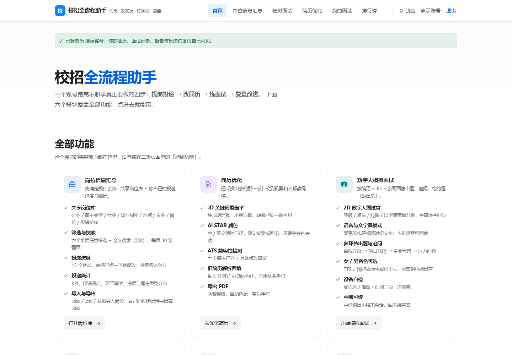
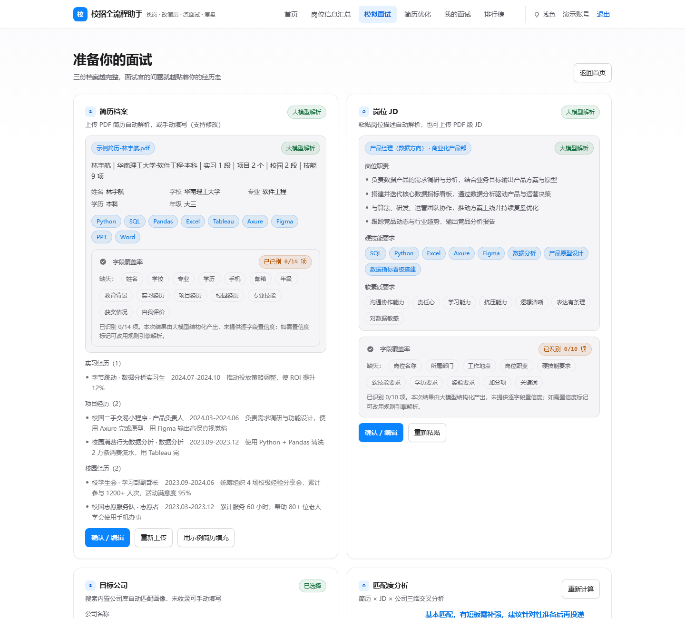
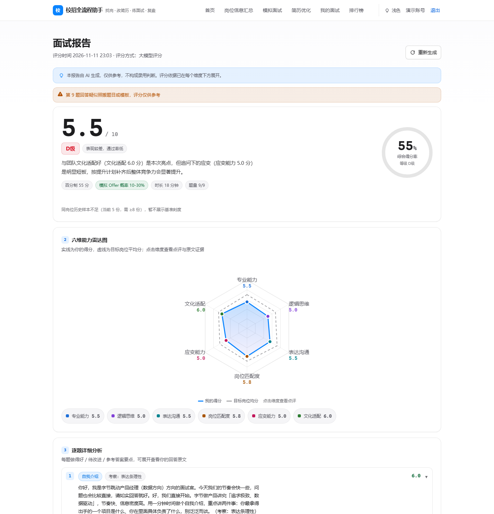
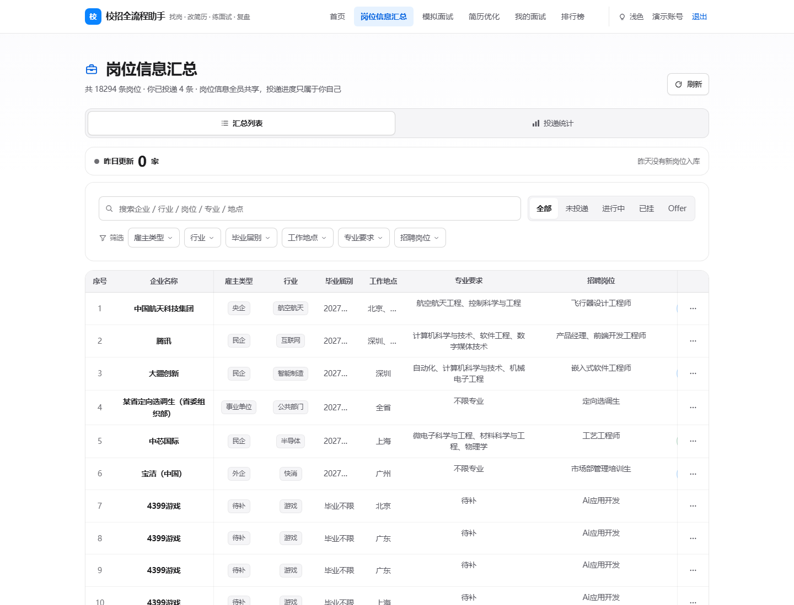

# 校招全流程助手

> 一个账号跑完校招真正要跑的四步 —— 找岗投递 → 改简历 → 练面试 → 复盘改进，配上会追问的 2D 数字人面试官与有依据的六维评分报告。

---

## 📌 项目简介

校招季的真实状态往往是：岗位收藏了一堆、简历改了很多版、真到面试还是不知道怎么答，面完也说不清自己差在哪。本项目把这四件事串成一条链路：共享岗位库 + 15 态投递进度；按 JD 看简历关键词、AI 润色、ATS 检测、导出 PDF；用简历 × JD × 公司画像出题的 2D 数字人面试（可语音作答、会被追问、中途退出能接着答）；结束后给出六维评分、逐题依据、同岗位分位基准与 7 天提升计划，并把低分题收进错题本。

- 适用场景：秋招 / 春招 / 实习投递管理、按目标岗位改写简历、面试前突击练习、面后复盘
- 亮点：不是「打字问答」而是真的像面试（有面试官、有追问、有口播实时反馈）；评分不只给分，还给依据与可执行计划；**零密钥也能完整跑通**（自动降级到规则引擎 + 浏览器语音）
- 规模：课程实践项目 · **3 人小组 · 4 周完成**（分工见「团队分工」）
- 口径：**所有功能对登录用户免费开放、不限次数**；数据按账号私有，服务端逐个接口判定归属

> 配套文档：[DESIGN.md](DESIGN.md) 放设计决策与已知边界（为什么这么做）；[API_CONTRACT.md](API_CONTRACT.md) 是接口契约的唯一事实来源；[DEPLOY.md](DEPLOY.md) 是云端部署手册。

## 🎬 演示入口

- **演示视频**：`demo/demo-video.mp4`（待录制补充；提交时请替换为课程群 / 网盘链接）
- **在线链接**：未部署（本地运行，见下方「安装与运行」；单进程模式只需一条命令即可对外提供完整服务）
- **截图**：见下一节（`screenshots/demo-1..4.png`，4 张真实运行截图）

## ✅ 功能特性

MVP 清单（全部实现）：

- [x] 账号与数据私有：注册 / 登录（PBKDF2 + 令牌）、他人资源一律 404、游客走进程内内存库不落盘
- [x] 岗位信息汇总：全员共享岗位库（8 大字段 + 六维筛选 + ⌘K 搜索）、15 态投递进度、投递统计（KPI / 漏斗 / 环节淘汰 / 分布）、.xlsx 导入与「我的投递」导出（零依赖自研 xlsx 读写）
- [x] 简历优化：JD 关键词覆盖率（纯规则、不耗额度）、AI STAR 润色（中 / 英，逐句接受或回退）、ATS 五模块检测、旧简历 PDF 解析回填、两套模板导出 PDF
- [x] 数字人模拟面试：2D 数字人（呼吸 / 点头 / 眨眼 / 口型随音频 RMS）、9 题多环节出题与追问、语音 / 文字双模式、女 / 男音色、设备自检、中断可续、口播实时反馈（语速 / 填充词 / 时长）
- [x] 六维评分报告：专业能力 / 逻辑思维 / 表达沟通 / 岗位匹配度 / 应变能力 / 文化适配，含逐题依据与原文高亮、同岗位分位基准、3 条优势 + 改进项、7 天计划、生成进度可视化（6 阶段 + 真实耗时）
- [x] 我的面试：报告回看、错题本（低于 6 分自动收集，可一键发起同环节 3 题微面试）、语音作答录音回放（只存本机 IndexedDB）
- [x] 成长与榜单：成长面板（连续打卡 / 近 7 天 / 维度首末对比）、三类排行榜（岗位 / 校园 / 进步，公开且不含个人隐私数据）
- [x] 零密钥降级：LLM → mock 规则引擎；TTS 三级降级（阿里云 → edge-tts → 浏览器原生 → 仅字幕）；ASR 回退浏览器 Web Speech API
- [x] 加分项 1：深色模式（跟随系统 / 浅色 / 深色三态）、压力面试模式、8 个行业专项题库
- [ ] 加分项 2：高保真数字人（百度曦灵 / 腾讯数智人）、简历深挖、RAG 题库检索 —— 本作业版本未做，见 [DESIGN.md](DESIGN.md) 的「后续迭代」

验收：打开首页点「一键体验示例简历」→ 自动载入示例简历 + JD + 字节跳动公司画像并算好匹配度 → 约 3 分钟走完一场并拿到六维报告 ✓

## 📸 截图



*图 1：首页 —— 页头 + 六模块功能矩阵（3×2）+ 我的面试报告*



*图 2：模拟面试准备页 —— 简历 / JD / 目标公司 / 匹配度两列排布，面试设置横跨整行*



*图 3：六维评分报告 —— 雷达、逐题依据与 7 天计划*



*图 4：岗位信息汇总 —— 共享岗位库 + 我的投递进度与统计*

> 以上 4 张为真实运行截图（登录态 + 示例简历 / JD / 公司画像 + 跑完一场 9 题面试并生成报告）。

## 🛠 技术栈与架构

**架构流程：**

```
输入：简历 PDF / 粘贴文本 + 岗位 JD + 目标公司画像
   │
   ▼
[档案解析] pdfplumber 提取文本 + LLM 结构化（无 Key 时规则引擎：板块切分 + 词表）→ 字段级置信度与覆盖率
   │
   ▼
[匹配度] 五维加权（硬技能 / 经验 / 学历 / 软素质 / 文化）→ 出题策略（聚焦 / 深挖 / 压力）
   │
   ▼
[面试循环] FastAPI + SQLAlchemy(SQLite) —— 9 题 6 环节出题 + 追问决策 + 行业题库
   │
   ├──▶ [语音链路] TTS：阿里云 NLS(HTTP) → edge-tts → 浏览器 speechSynthesis（3.5s 时间预算，超时即降级）
   │              ASR：浏览器 Web Speech API ⇄ 阿里云实时识别（16k 单声道 PCM 分块上传）
   ▼
[评分] LLM 两轮评分 + 规则引擎兜底（术语密度 / 结构化词 / JD 命中 / 量化数据 / 口头禅 / 防作弊）
   │
   ▼
[报告与复盘] 六维 + 逐题证据 + 同岗位基准 + 7 天计划 + 错题本 + 历史曲线
   │
   ▼
[网页端] React 18 + Vite（无 UI 框架）—— 数字人、字幕、录音与报告全部自绘
```

**选型理由：**

| 工具 | 选型理由 | 额度说明 |
|---|---|---|
| FastAPI + SQLAlchemy + SQLite | 单进程即可跑、零运维；接口文档 `/docs` 自动生成 | 开源免费 |
| React 18 + Vite（不用 UI 库） | 数字人 / 字幕 / 录音需要细粒度控制，引 UI 库只会和自绘样式打架 | 开源免费 |
| DeepSeek / 通义千问 / 智谱 GLM / Kimi / OpenAI（统一 OpenAI 兼容） | 一套客户端配 5 家，换厂商只改 `.env`；也可切本地 Ollama | 各厂商均有免费额度 |
| edge-tts | 微软免费，带字级时间戳，字幕能逐字同步 | 免费 |
| 阿里云 NLS（TTS / ASR） | 音色更自然；TTS 走 RESTful HTTP，无需装 SDK | 需开通，按量计费 |
| pdfplumber + wkhtmltopdf(pdfkit) + Jinja2 | 解析稳定、PDF 排版可控（自动挑「塞进一整页」的字号） | 本地免费 |
| 零依赖 xlsx（自建 ZIP + XML） | 只为导入导出引入 SheetJS 不划算，浏览器原生 `DecompressionStream` 即可 | 免费 |

**设计取舍**：

- **零密钥优先**：所有模型调用都「失败即降级」，绝不 500。例外是简历的「AI 润色 / ATS 检测」——结果会被直接拿去投递，不能用规则引擎编，未配 Key 时按钮置灰并说明原因。
- **诚实优先**：LLM 不可用时用规则引擎并在报告里标注评分方式；样本不足时如实写「数据还少」而不编造趋势；生成进度只按真正完成的阶段算百分比。
- **语音三级降级**：面试官始终有声音（后端音频 → 浏览器原生 → 静音仅字幕）。
- **数据私有**：身份只认 `Authorization: Bearer`，他人资源返回 **404 而不是 403**（403 会泄露「这个 id 真实存在」）。
- **不计费**：没有会员等级与次数限制，登录即用，所有功能不限次数。

## 🔁 与期中版「AI 简历生成器」（v1）的改进对照

> 本项目是期中版 `ai_resume_project`（单体 FastAPI 单文件 + 单页原生前端，只做简历润色 / ATS / PDF 导出）的深化结果。
> 课程「较大改进」认定要求五条标准满足 3 条，本版**申报 ①新功能模块、③技术路线升级、⑤体验打磨**（②量化盲评与 ④公网部署未做，不申报）。

### 功能维度

| 能力 | v1 期中 | v2 期末 | 证据 |
|---|:---:|:---:|---|
| 简历润色（中 / 英） | ✅ | ✅ 保留，接入统一多厂商 LLM 客户端 | `services/resume_optimizer.py` |
| ATS 五模块检测 | ✅ | ✅ 保留 | 同上 |
| 双模板 PDF（自动适配一整页） | ✅ | ✅ 保留 | `templates/resume/`、`services/resume_doc.py` |
| 旧简历 PDF 解析回填 | ✅ | ✅ 保留（扫描件 OCR 兜底未移植） | `services/pdf_parser.py` |
| 处理进度可视化 | ✅ SSE 实时（字数 / 试排次数） | ✅ 6 阶段 + 真实耗时（轮询） | `GET /api/report/{id}/progress` |
| **岗位信息汇总 + 15 态投递进度 + 统计** | ✗ | ➕ 新增 | `routers/jobs.py`、截图 4 |
| **数字人模拟面试**（语音 / 文字、追问、中断可续） | ✗ | ➕ 新增 | `routers/interview.py`、截图 2 |
| **六维评分报告**（逐题依据 + 基准 + 7 天计划） | ✗（仅 ATS 单项检测） | ➕ 新增 | `services/scoring.py`、截图 3 |
| 错题本 + 录音回放 | ✗ | ➕ 新增 | `services/practice_store.py` |
| 成长面板 + 三类排行榜 | ✗ | ➕ 新增 | `services/analytics.py` |
| 账号体系与数据私有 | ✗（单用户、无鉴权） | ➕ 新增（令牌 + 归属 404 + 游客内存库） | `deps.py`、`routers/auth.py` |
| 一键分享海报 | ✗ | ➕ 新增 | `GET /api/report/{id}/share`、`Report.jsx` |

**新增模块计数 5 个**：岗位信息汇总、数字人模拟面试、六维评分报告、我的面试、成长与榜单（另加「账号与数据私有」横切能力）。

### 指标维度

| 指标 | v1 期中 | v2 期末 | 变化 |
|---|---|---|---|
| 后端代码 | 9 文件 / 3,293 行 | 48 文件 / 15,713 行 | 4.8× |
| 前端代码 | 单一静态页 + 4 个 PDF 模板，共 2,880 行 | 49 个 JS/JSX（15,791 行）+ 15 个 CSS（8,272 行） | 8.4× |
| 业务接口 | 7 个（另 2 个辅助） | **60 个（54 条路径）** | 8.6× |
| 数据表 | 0（无持久化） | 11 张 | 0 → 11 |
| 模型厂商接入 | 1（DeepSeek） | 5 家在用的兼容厂商 + 本地 Ollama + mock 规则引擎 | 1 → 7 条路径 |
| 自动化校验 | 4 个测试文件 / 1,695 行 | **300 项断言**（60 + 165 + 75）+ 6 道前端门禁 | 覆盖率大幅提升 |
| 构建产物 | 无（单文件直接托管） | JS 483.52 kB（gzip 162.81）+ CSS 128.27 kB（gzip 21.61） | 新增构建管线 |
| 单场能力覆盖 | 1 次润色 + 1 次 ATS | 9 题面试 + 2 轮评分 + 六维报告 + 7 天计划 | 信息量大幅提升 |

### 架构维度

| 维度 | v1 期中 | v2 期末 |
|---|---|---|
| 后端组织 | 单体 `main.py`（53 KB 单文件承载全部接口） | 8 个路由模块 + 28 个服务模块 + 11 张表的分层结构 |
| LLM 接入 | DeepSeek 单厂商、`requests` 同步调用 | 统一 OpenAI 兼容客户端：5 厂商 + 本地 Ollama + mock；`httpx` 异步 + 超时 / 重试 / 失败降级 |
| 用户模型 | 无（单用户本地使用、无持久化） | 注册登录（PBKDF2 + 令牌哈希存储）+ 归属校验（他人资源 404）+ 游客走进程内内存库 |
| 语音能力 | 无 | TTS 三级降级（阿里云 NLS → edge-tts → 浏览器原生 → 仅字幕）+ ASR 双通道 |
| 前端形态 | 原生单页 HTML（样式脚本全内联） | React 18 + Vite 组件化；语义令牌双主题；响应式与移动端安全区；无障碍（字幕 `role=status`、焦点路径） |
| 数据与状态 | 无数据库、无会话 | SQLite 11 表；会话超时自动收敛（`ongoing → aborted`） |
| 部署与运维 | `Dockerfile` + `render.yaml`（未实际部署） | 多阶段 `Dockerfile` + `docker-compose`（app + Caddy 自动 HTTPS）+ `deploy/backup.sh` + 启动自愈（会话收敛 / 过期令牌清理） |
| 可观测性 | `logging` + SSE 事件流 | 启动诊断日志（LLM / TTS / ASR / PDF 逐条打印）+ 全局兜底异常处理（不白屏）+ 报告生成 6 阶段进度 |

> 表中数字可复现：`python -c "from app.main import app; s=app.openapi(); print(len(s['paths']))"` → 54 条路径 / 60 个接口；`Select-String backend/app/models.py -Pattern '__tablename__'` → 11 张表；三套自检 `test_auth_flow.py`（60）/`test_experience_flow.py`（165）/`test_jobs_flow.py`（75）全绿；截图见上一节。

## 🚀 安装与运行

### 环境要求

- Windows 10 / macOS / Ubuntu 20.04+（Windows 下有一键脚本，最省事）
- Python 3.10+（推荐 3.11）
- Node.js 18+（只有开发前端 / 重新构建产物才需要；直接跑已构建的产物不需要）
- 可选：**wkhtmltopdf**（[下载](https://wkhtmltopdf.org/downloads.html)，简历 PDF 导出用；不装则只有该按钮返回 503）
- 可选：任一 LLM Key（DeepSeek / 通义 / 智谱 / Kimi / OpenAI，或本地 Ollama）—— **不配也能跑**（mock 模式）
- 可选：阿里云 NLS 凭据（更自然的 TTS / 云端 ASR）—— 不配则用 edge-tts + 浏览器识别

### 安装步骤

```powershell
# 1. 进入项目目录（仓库目录名沿用 ai-interview-coach）
cd ai-interview-coach

# 2. 后端依赖
cd backend
pip install -r requirements.txt

# 3. 配置环境变量（可选：不配就是零密钥演示模式）
Copy-Item .env.example .env
# 编辑 .env，任填一个即可：DEEPSEEK_API_KEY / DASHSCOPE_API_KEY / ZHIPU_API_KEY / MOONSHOT_API_KEY / OPENAI_API_KEY
# 语音升级（可选）：ALIYUN_ACCESS_KEY_ID / ALIYUN_ACCESS_KEY_SECRET / ALIYUN_TTS_APPKEY / ALIYUN_ASR_APPKEY

# 4. 前端依赖（只在需要开发或重新构建时）
cd ..\frontend
npm.cmd install
```

### 启动

```powershell
# 方式一：一键启动（Windows；后端 + 前端 dev + 自动开浏览器）
cd ..
.\start.cmd
# 后端 http://127.0.0.1:8000   前端 dev http://127.0.0.1:5173
# 端口被占时换端口并行跑：
.\start.cmd -BackendPort 8010 -FrontendPort 5183

# 方式二：手动（两个终端）
cd backend  ; python -m uvicorn app.main:app --reload --port 8000
cd frontend ; npm.cmd run dev

# 方式三：单进程（答辩演示最稳，不需要 Node）
cd frontend ; npm.cmd run build
cd ..\backend ; python -m uvicorn app.main:app --port 8000
```

浏览器打开 `http://127.0.0.1:8000/`（接口文档：`http://127.0.0.1:8000/docs`）。

### 常见问题（FAQ）

| 问题 | 解决办法 |
|---|---|
| 提示「禁止运行脚本」 | 改用 `.\start.cmd`（内置绕过执行策略），或 `Set-ExecutionPolicy -Scope CurrentUser RemoteSigned` 后**新开**窗口再跑 |
| 端口 8000 被别的项目占用 | 启动脚本会**校验端口归属**并报出占用进程的 pid，不会把别人的页面当成本项目；用 `-BackendPort 8010 -FrontendPort 5183` 并行跑 |
| 启动脚本凭什么判断「这个端口上是本项目」 | 后端比对 `GET /api/health` 的 `app_id=ai_project`，前端比对页面里的 `application-name`；不一致就停下 |
| 没有 API Key 能玩吗 | 能。LLM 自动进 mock 模式（规则引擎出题 / 评分），TTS 走 edge-tts，ASR 走浏览器；只有「AI 润色 / ATS 检测」会置灰 |
| 面试官没有声音 | 看启动日志 `[boot] TTS ...` 那一行；浏览器需允许播放声音；Safari 需 HTTPS 或 localhost |
| 麦克风点了没反应 | 浏览器只在 HTTPS 或 localhost 下授予麦克风权限；也可以直接切「文字模式」作答 |
| 下载简历 PDF 返回 503 | 未安装 wkhtmltopdf；安装后重启（或设 `WKHTMLTOPDF_PATH`） |
| 想确认当前用哪家模型 | `GET /api/health/llm`（只报告「配没配 / 为什么没生效」，不含任何密钥） |

## 📖 使用说明

1. 打开首页，点「一键体验示例简历」：自动载入示例简历 + 示例 JD + 字节跳动公司画像并算好匹配度；
2. 也可以自己上传 PDF 简历（或粘贴文本）、粘贴 JD、选择目标公司，页面会实时显示五维匹配度与建议的出题策略；
3. 选面试官音色与作答方式（语音 / 文字），点「开始模拟面试」—— 默认 9 题、6 个环节，中途退出不结束会话，回来接着答；
4. 答完自动进入六维报告：总分与雷达、逐题依据与更好的说法、同岗位 P25/P50/P75 对照、7 天计划；
5. 低于 6 分的题自动进「我的面试 → 错题本」，可一键发起同环节 3 题微面试；语音作答的录音只存本机，可回放或删除。

求职前后还可以顺手用另外两块：先在「岗位信息汇总」记投递进度（15 个状态、漏斗统计），再去「简历优化」按目标 JD 改一版（关键词覆盖 → 润色 → ATS → 导出 PDF）。

## 📁 目录结构

```
ai-interview-coach/
├─ API_CONTRACT.md           # 接口契约（唯一事实来源）
├─ DESIGN.md                 # 设计决策与已知边界（为什么这么做）
├─ DEPLOY.md                 # 云端部署手册（Docker + Caddy 自动 HTTPS）
├─ Dockerfile / docker-compose.yml   # 生产镜像（多阶段）与编排
├─ start.ps1 / start.cmd     # 一键启动（后端 + 前端，含端口归属校验）
├─ deploy/                   # Caddyfile、deploy.sh、backup.sh
├─ backend/
│  ├─ requirements.txt
│  ├─ .env.example           # 环境变量模板（不含真实 Key）
│  ├─ test_*_flow.py         # 三套自检（300 项断言，各用独立临时库）
│  └─ app/
│     ├─ main.py             # FastAPI 入口（单进程托管前端产物 + 兜底异常处理）
│     ├─ config.py           # 配置（零密钥可运行，.env 覆盖）
│     ├─ constants.py        # 六维模型 / 面试环节配比 / 语速阈值 / 行业题库 / 15 态投递字典
│     ├─ schemas.py          # 全部 Pydantic 数据契约
│     ├─ models.py           # 数据表（简历 / JD / 会话 / 错题 / 岗位库 / 投递进度 …）
│     ├─ db.py / deps.py     # 引擎与会话（游客走内存库）/ 鉴权与归属校验
│     ├─ data/               # companies.json（50 家公司画像）、jobs_seed.json（20 条示例岗位）
│     ├─ prompts/templates.py
│     ├─ templates/resume/   # 简历 PDF 模板（两套）
│     ├─ routers/            # 8 个路由模块
│     └─ services/           # 业务引擎（解析 / 匹配 / 面试 / 评分 / 报告 / 语音 / 岗位库…，职责见 DESIGN.md）
└─ frontend/
   ├─ index.html / package.json / vite.config.js
   └─ src/
      ├─ api/client.js       # 统一请求封装（令牌注入 + 401 拦截 + 超时/重试）
      ├─ auth/ theme.js      # 登录态 / 深色模式
      ├─ components/         # 通用组件 + jobs/ 岗位模块组件
      ├─ hooks/              # useSpeech / useRecorder / useAnswerRecorder / useSpeechMetrics / useVisibility
      ├─ lib/                # 零依赖 xlsx 读写、格式化函数
      ├─ storage/            # 本机录音仓库（IndexedDB）
      ├─ styles/             # 语义令牌与全局样式（深浅两套主题）
      └─ pages/              # Login / Home / JobHub / Setup / ResumeOptimize / Interview / Report /
                             # MyInterviews / Leaderboard
```

## 👥 团队分工

| 姓名 | 角色 | 负责模块 |
|---|---|---|
| 安县军 | 队长 / 产品与后端 | 需求与验收口径、账号与数据私有、面试主循环、六维评分与 7 天计划、报告编排 |
| 曹腾飞 | AI 与数据 | 大模型接入与降级、简历与 JD 解析、五维匹配度、简历优化与 PDF 导出、语音（TTS / ASR）、示例数据 |
| 陈宇轩 | 前端 / 集成 / 部署 | 九个前端页面、数字人与字幕、语音前端、双主题与响应式、岗位库前端、自检门禁与 Docker 部署 |

## 🤖 AI 使用声明

- 后端与前端代码主体由 **AI 编程助手（DeepSeek Harness）** 辅助生成，**各模块负责人**逐段阅读、运行自检并修正后才合入；
- 设计文档（`DESIGN.md`）与接口契约（`API_CONTRACT.md`）是「先定契约 → 再实现 → 最后跑自检」的产物：AI 负责实现与补注释，口径与边界（哪些功能不做、哪些情况必须降级）由各组员按分工决策；
- 六维评分权重、追问触发规则、7 天计划模板与 Prompt 由后端两位同学设定并逐条核对，AI 仅做措辞与结构化；
- 界面文案为项目自写（部分由 AI 起草后人工改写），未直接照搬任何教程或开源项目的文案；
- 依赖与 API 参数（edge-tts 语速、阿里云采样率、大模型超时阈值等）参照官方文档调整；
- 内置的示例简历、20 条示例岗位与 50 家公司画像仅用于演示（公开信息整理 + 自造数据），界面上已标注「示例 / 演示数据」。

## 📚 参考文献

- [FastAPI 官方文档（依赖注入 / 异步 / OpenAPI）](https://fastapi.tiangolo.com/)
- [React 官方文档（Hooks 与状态管理）](https://react.dev/)
- [Vite 官方文档（开发服务器与构建）](https://vitejs.dev/)
- [DeepSeek API 文档（OpenAI 兼容协议与 JSON 输出）](https://api-docs.deepseek.com/)
- [阿里云智能语音交互 NLS 文档（TTS / 实时 ASR）](https://help.aliyun.com/zh/isi/)
- [edge-tts（微软免费 TTS，含字级时间戳）](https://github.com/rany2/edge-tts)
- [pdfplumber（PDF 文本提取）](https://github.com/jsvine/pdfplumber)
- [wkhtmltopdf 官方文档（HTML 转 PDF 与字号缩放）](https://wkhtmltopdf.org/)
- [MDN Web Speech API（浏览器语音识别）](https://developer.mozilla.org/zh-CN/docs/Web/API/Web_Speech_API)
- 课程材料《热门 AI 项目与技术 2026》—— 本项目的选题方向与六维评分维度参考

## 📄 许可证与致谢

- 本项目为课程实践作业性质，代码供课程评审与学习使用；
- 感谢指导老师在选题与演示上的建议；
- 感谢 DeepSeek、阿里云与微软 edge-tts 提供的额度与免费能力，使「零密钥也能完整跑通」成为可能；
- 内置公司画像与示例岗位仅用于演示，具体招聘信息以企业官方公告为准；面试评分结果为练习参考，不构成任何录用承诺。
